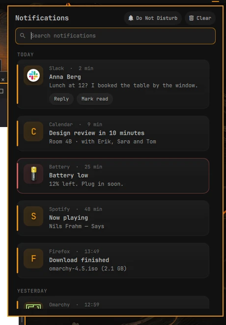
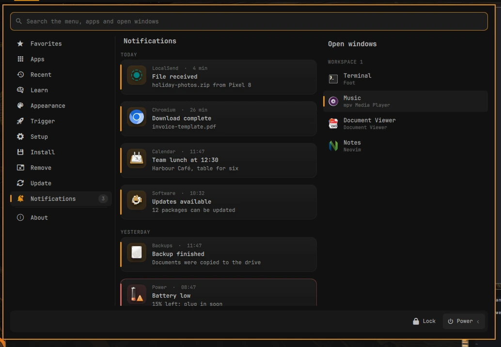

# omext bell

Part of [**omarchy-extended**](https://github.com/omarchy-extended): addons for [Omarchy](https://omarchy.org).

Your notification history, on the bar. A bell with how many came since you
last looked; a click shows them all, by day, newest first, to search, act on,
put away or clear. Omarchy's own pop-ups stay as they are.



## What's in it

- **The bell** at the right end of the bar: a count of the new ones, and a
  struck-through bell while Do Not Disturb is on. Left click opens the history,
  right click turns Do Not Disturb on or off.
- **Cards**, grouped by day: the app's icon (or the notification's own picture),
  who and when, the summary and up to three lines of the rest. An accent line
  down the left side, red for urgent ones. New ones slide in, and the rest
  move along smoothly when one goes.
- **A click** does what the pop-up would have done (its command), or goes to the
  app's window. The notification's own buttons (Reply, Open, ...) are on the
  card too.
- **Search** covers the app, the summary and the text.
- **Keys.** Up and Down choose a notification, Enter does what a click on it
  does, Delete takes it off the list, Esc closes.
- **✕** (on hover) puts one away, **Clear** all of them. Only here: Omarchy's
  history file is never written to, so its own history view still has them.
- **Do Not Disturb**, the same switch as Omarchy's.
- **In [omext start](https://github.com/omarchy-extended/start)**, with both
  installed: a Notifications page in the menu, or a column at its right, at the
  menu's own text size. Start can then take the bell off the bar (the gear on its
  Notifications heading › Hide the bar's bell); it comes back when Start is off or gone.



## Settings

The gear at the top right. They're kept in `~/.config/omext/bell.json`, the
same for the bell on every screen (the size is the bell's own: Start shows the
list at its menu's size).

- **Size**: Compact, Default, Large or Extra large. The panel, and the cards
  and their text with it; never more than the screen has room for.
- **Count of new ones on the bell**: on, or just the bell.

Notifications Omarchy keeps only as a placeholder (ones that look like they
carry a code or a password) show as "Hidden notification".

## From a script

```bash
omarchy-shell omext.bell toggle      # or open, close: on the screen that has the focus
omarchy-shell omext.bell settings
omarchy-shell omext.start page notifications
```

## Compatibility

Needs **Omarchy 4.5** or later (tested on 4.5.0). It reads the history
Omarchy's notification service keeps in
`~/.local/state/omarchy/notifications/history.json` (its last 100), and uses
that service's own code for icons, links and buttons, from
`/usr/share/omarchy/shell/plugins/notifications/`. If a future Omarchy changes
those, the bell may need an update too.

It uses [omext core](https://github.com/omarchy-extended/core) (what the omext
addons share): `install.sh` installs that too, when it's missing.

## Install

```bash
git clone https://github.com/omarchy-extended/bell.git ~/.local/share/omext-bell
~/.local/share/omext-bell/install.sh
```

The bell goes on the bar after the power button. Move it like any other bar
widget, for example with `omarchy bar move omext.bell --section center`. Turn it
off or on in the Omarchy menu › Setup › Omarchy Extended › Bell. A `git pull` in
that folder updates it. `./uninstall.sh` removes it.

## Files

| Path | What |
| --- | --- |
| `plugins/omext.bell/` | The Omarchy shell plugin: the bell (`Panel.qml`), the history (`History.qml`) and the list (`NotificationList.qml`, which Start uses too). |
| `menu.jsonc` | The Bell entry (on or off) for the Omarchy menu. |
| `install.sh`, `uninstall.sh` | Link the plugin into `~/.config/omarchy/plugins/`, add the Omarchy menu entry and put the bell on the bar, or take it all off again. |

What you put away or cleared is kept in `~/.local/state/omext/bell/state.json`.

## License

MIT. See [LICENSE](LICENSE).
